<div align="center">
  

<br/>

[](https://github.com/d-murza)
[](https://www.linkedin.com/in/dmytro-murza)
[](mailto:dmytro.murza.work@gmail.com)


</div>

---

## 🏁 Driver Profile

I'm a **software engineer** and **Computer Science Master's student at the University of Konstanz**. I started on the systems side: as R&D team lead I built a high-frequency **crypto trading terminal in C#/.NET** used by 2,000+ customers, and I added distributed tracing to cloud video encoding services at **Bitmovin**. Now I'm adding **machine learning** to that: multimodal RAG, LLM fine-tuning and vision foundation models.

I like building complete systems end to end, from the model or the concurrency model down to the API, the UI, and the bug that only appears under load.

Off the keyboard, I'm a car person. Hence the circuit below.

```yaml
driver:
  name:       Dmytro Murza
  team:       M.Sc. Computer Science @ University of Konstanz
  previously: B.Sc. Computer Science @ Constructor University
  engine:     [C# / .NET, Python, PyTorch, TypeScript, C / C++, Java]
  specialty:  [Concurrent & real-time systems, Backend, Multimodal RAG, LLM fine-tuning]
  languages:  { English: C1, German: B1 }
  setup:      "Simplify, then add lightness."
  off_track:  cars, motorsport, and anything with a well-tuned engine
```

---

## 🏎️ Race History · Experience

- 📈 **R&D Engineer (Team Lead)** · VPMF Technologies OÜ, Tallinn · *09/2023 – 08/2026*
  Built a WPF trading terminal (C#/.NET) for high-frequency crypto trading that integrates 6 exchanges (Binance, Bybit, OKX, …) and has 2,000+ customers. Built parallel data ingestion with async/await, concurrent collections and producer/consumer pipelines. Hunted down memory leaks, deadlocks and race conditions using dumps and regression tests. Led a team of 3 engineers in Agile sprints. Product overview videos (in Russian) are on the [ProfitForge YouTube channel](https://www.youtube.com/@ProfitForgeOfficial).
- 🎬 **Software Engineering Intern** · Bitmovin, Berlin · *06/2024 – 08/2024*
  Added OpenTelemetry distributed tracing across cloud video encoding services, with trace context propagated through the HTTP pipeline. Worked in C++, Java and Kotlin, and tested with Google Test and JUnit. Monitored services in Kibana and verified encoding output with FFmpeg and MP4Box.
- 🧑‍🏫 **Teaching Assistant: Operating Systems** and **Digital Systems & Computer Architecture** · Constructor University · *2024 – 2025*
  Mentored 100+ students in concurrency, scheduling, synchronization, memory management, Verilog and CPU fundamentals.
- 🎓 **Academic project: Concurrency and data synchronization in real-time financial applications** · Constructor University · *05/2025* · grade 1.0
  Compared thread-based and task-based concurrency models for low-latency trading, and evaluated synchronization primitives and concurrent collections.

---

## 🏆 Podium · Featured Builds

| | Build | What it does | Under the hood |
|:-:|:--|:--|:--|
| 🔎 | **[Multimodal RAG Assistant](https://github.com/d-murza/multimodal-rag-assistant)** | Answers "how do I…?" questions: retrieves WikiHow articles, generates grounded steps with a local LLM, and matches each step to a HowTo100M video clip. | `RAG` `FAISS` `CLIP` `TinyLlama` `Gradio` |
| 🧬 | **[Qwen3 Patent Classifier](https://github.com/d-murza/qwen3-patent-classifier)** | LoRA fine-tuning of Qwen3-0.6B with completion-only loss masking; raises patent IPC classification F1 from 0.05 to 0.44 on a single T4. | `PEFT` `LoRA` `Transformers` |
| 👁️ | **[Vision Foundation Models](https://github.com/d-murza/vision-foundation-models)** | Zero-label anomaly detection with DINOv2 patch features (0.98 mean AUROC on MVTec-AD), plus segmentation and monocular depth. | `DINOv2` `SegFormer` `Depth Anything` |
| 🗓️ | **[PlanIt](https://github.com/d-murza/PlanIt_WebApp)** | Schedule desktop automations from the web: .NET microservices push triggered plans over RabbitMQ and SignalR to an Electron client. | `.NET` `RabbitMQ` `SignalR` `React` `Docker` |
| 🌐 | **[InvestBud Podillia](https://investbud-podillia.com.ua/)** | Production website for a Ukrainian construction company: bilingual, project portfolio with city filters, interactive map, lead form. | `Web` `Vite` `Leaflet` |
| 🧪 | **[Machine Learning Labs](https://github.com/d-murza/machine-learning-labs)** | Transformers and ViTs written from scratch, autoencoders vs. VAEs, DINOv2 image search, T5 vs. TinyLlama. | `PyTorch` `Transformers` |
| 🔌 | **[TCP Word Game Server](https://github.com/d-murza/tcp-word-game-server)** | Multiplayer game server in C: single-threaded libevent loop, non-blocking IPv4/IPv6 sockets. | `C` `libevent` `sockets` |

---

## 🔧 The Garage · Tech Stack

<div align="center">

**Languages**


**Backend & Desktop**


**Machine Learning**


**Infrastructure, Observability & Tooling**


</div>

---

## 📈 Telemetry · Contribution Circuit

<div align="center">
  
  <sub>Every kerb block is a day of the year. The car laps the track, and busy days light up as it passes. Rebuilt daily by a GitHub Action.</sub>
</div>

<br/>

<div align="center"><sub>🏁 Thanks for stopping by the pit lane.</sub></div>
